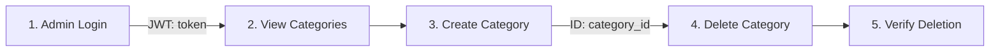

# Step 03 — Xác minh Category Management & Verification

Ngày: **17/11/2026**, múi giờ Asia/Saigon (UTC+07:00). Workspace `E:\KiemThu\HW05`; backend `http://localhost:3000`; Admin web `http://localhost:5174`; JMeter dự kiến **5.6.3**. Pools được chọn theo yêu cầu: **Pool A — Authentication + Pool C — Category Management**.

## 1. Tóm tắt và kết luận

**Khuyến nghị: CONDITIONAL GO** cho việc dùng workflow Category Management làm đầu vào xây dựng Skill/test plan ở bước sau. **[SMOKE]** Một vòng API tuần tự đã chạy thành công: admin Login → View Categories → Create Category → Delete Category → Verify Deletion. Có thêm GET kiểm tra bản ghi sau Create và các probe xác thực/DELETE lặp để thu bằng chứng; các request bổ sung không tự trở thành bước bắt buộc của performance workflow.

**[SMOKE]** Danh mục tạm ID **4** được tạo, xác nhận đúng ID/tên rồi xóa. Sau cleanup, ba danh mục gốc và toàn bộ năm sản phẩm bằng baseline trước chạy; admin vẫn `login_attempts=0`, `locked_until=null`. Hash năm file source/đặc tả và hai báo cáo trước không đổi. Backend hiện hữu vẫn ở PID 7900; không restart/reset/reseed hoặc ghi SQL trực tiếp.

**[SRC]** Các giới hạn cần chấp nhận/ghi nhận trước bước tiếp theo: mutation category chỉ kiểm tra JWT, thiếu kiểm tra role admin; name không có validation; không có ràng buộc unique name; DELETE không kiểm tra số dòng bị xóa; không có bảo vệ liên kết product/category. **[SMOKE]** DELETE lại ID đã xóa vẫn trả thành công 200. **[HYP]** Khả năng chịu tải, contention, độ trễ, throughput và độ bền khi có request đồng thời chưa được kiểm chứng.

CONDITIONAL GO không đồng nghĩa đủ điều kiện triển khai thật, đáp ứng đầy đủ FR-12/FR-14, hay đã đạt yêu cầu hiệu năng. Chưa tạo CSV/JMX/Agent Skill và chưa chạy performance test.

## 2. Lý do đổi workflow và quy ước bằng chứng

Theo quyết định mới của người dùng, **Category Management & Verification thay Shopping Cart Management**. [02-api-analysis.md](02-api-analysis.md) ghi nhận cart backend thiếu Update/Remove/Clear API, cart web lại lưu React state riêng. Workflow cũ không đủ sáu bước HTTP có thể lặp với cleanup hợp lệ. Admin Product Management đã được cân nhắc nhưng không được chọn vì Category đơn giản hơn.

Workflow mới có authentication, read và hai thao tác **ghi/xóa SQLite thực tế**, cùng bước xác minh trạng thái cuối. Năm bước là **bốn hợp đồng endpoint-method khác nhau**, vì View và Verify dùng lại GET categories; không diễn giải thành năm endpoint riêng biệt.

Giữ nguyên [01-environment.md](01-environment.md) và [02-api-analysis.md](02-api-analysis.md) như lịch sử. README/AGENTS của repository vẫn nhắc Shopping Cart; báo cáo này ghi nhận quyết định mới, không tự sửa các file đó. Yêu cầu Step 03 mới xác định phạm vi công việc hiện hành.

Nhãn bằng chứng:

- **[SPEC]**: SRS trong `eshop-sut/README.md` hoặc API specification; ghi rõ nguồn khi khác nhau.
- **[SRC]**: kết luận đọc handler, middleware, schema hoặc frontend; không phải mặc nhiên đã gọi request kiểm chứng.
- **[SMOKE]**: quan sát thực tế trong lần chạy được ghi tại [03-category-smoke.json](../../audit/03-category-smoke.json).
- **[HYP]**: giả thuyết chưa đo/kiểm chứng bằng workload tương ứng.
- **[ĐỀ XUẤT]**: hướng chuẩn bị JMeter và dữ liệu, chưa triển khai thành CSV/JMX/Skill.

Script thực thi: [smoke-category.cjs](../../audit/smoke-category.cjs). JSON lưu timestamps, baseline đầy đủ categories/products, kết quả request đã làm sạch, source/report hashes, schema read-only, trạng thái admin, cleanup và các giới hạn. Không lưu mật khẩu, JWT, login response thô hoặc thông tin hồ sơ user.

## 3. Ánh xạ đặc tả, source và frontend Admin

### 3.1 Đặc tả trọng tâm

| Nguồn [SPEC] | Yêu cầu | Source tương ứng [SRC] | Kết luận |
| --- | --- | --- | --- |
| SRS FR-02, `README.md:38–44` | Sai password tăng 1; khóa sau >=3 lần sai, 30 giây; dùng JWT | `backend/server.js:32–66` | Source tăng **2**, khóa **180 giây**; không cố ý khóa admin để test |
| SRS FR-12, `README.md:174–179` | Mutation products/categories/coupons cần JWT hợp lệ **và role admin trong token** | `server.js:100–110,249–278` | Có authenticateToken, không có admin-role guard |
| SRS FR-14, `README.md:186–189` | Admin Thêm/Xem/Xóa; name bắt buộc, không trống | `server.js:243–278`; `database.js:23–26` | CRUD được hỗ trợ; không validate name, schema name chỉ TEXT |
| API spec `api_specification.md:23–32` | POST login, body email/password, thành công 200 có token/user | `server.js:32–66` | Mapping đúng route; response user có trường nhạy cảm cần bỏ khỏi log |
| API spec `api_specification.md:102–106` | GET/POST categories, PUT/DELETE categories/:id | `server.js:243–278` | Có đủ route; PUT có nhưng nằm ngoài workflow được chọn |

SRS là căn cứ kiểm tra role/name; mục Categories trong API spec chỉ liệt kê endpoint/body, không ghi status Create/Delete cụ thể, không quy định unique name hoặc DELETE nonexistent phải trả 404. Không tự gán những yêu cầu đó cho đặc tả.

### 3.2 Cách frontend-admin thực sự gọi API

**[SRC]** `frontend-admin/src/App.jsx`:

- Dòng 4: API base `http://localhost:3000/api`; dòng 7: token lấy từ localStorage `adminToken`.
- Dòng 61–73: POST login, **frontend** kiểm tra `res.data.user.role === 'admin'` trước khi lưu token. Đây không thay thế backend authorization.
- Dòng 34–59: khi có token, gắn Axios default `Authorization: Bearer ...`, rồi `fetchData()` lần lượt GET admin/users → admin/orders → products → categories → coupons. Login UI và refresh bảng không chỉ gọi Categories.
- Dòng 142–150: POST categories với `{name: categoryName}`, xóa input rồi gọi `fetchData()`; không đọc ID Create từ response để giữ biến nghiệp vụ.
- Dòng 153–160: DELETE categories/${id} từ ID của dòng được render, rồi `fetchData()`; không có confirm dialog trong handler này.
- Dòng 294–333: input name không có `required`, không trim/kiểm tra trống; render ID/tên và nút Xóa. `c.name || ''` có thể che name null trên bảng.

Workflow backend được chọn **tương ứng cùng các HTTP Create/Delete mà UI sử dụng**, khác cart trước đó. Tuy nhiên, năm bước JMeter đề xuất là luồng API có scope hẹp; không đại diện toàn bộ tải phát sinh của màn hình Admin vì đã bỏ các request refresh users/orders/products/coupons. Bổ sung GET xác minh Create ở smoke cũng không tự đưa vào workflow hiệu năng. Chưa chạy smoke giao diện Admin trong Step 03; so sánh UI ở đây là [SRC].

## 4. Hợp đồng endpoint và assertions

Base URL: `http://localhost:3000`. Gửi `Accept: application/json`; POST JSON dùng `Content-Type: application/json`. Route mutation gửi `Authorization: Bearer ${token}`. Không cần cookie/CSRF token theo source. Ví dụ `${...}` là biến runtime, không phải credential thật.

### 4.1 Admin Login — POST /api/login

**Phân loại:** Pool A; Auth-heavy. **Tham chiếu:** `server.js:32–66`, frontend `App.jsx:61–73`, API spec `23–32`.

```http
POST /api/login
Content-Type: application/json
Accept: application/json

{"email":"${admin_email}","password":"${admin_password}"}
```

Không query/path parameter, không cần Authorization. **Tiền điều kiện:** admin hiện có, đúng password, role admin, không đang locked; SQLite đọc được. Response thành công [SPEC/SRC]: HTTP 200, object có `message="Login successful"`, `token`, `user`. Chỉ giữ token và user.id/role trong bộ nhớ; không lưu `user` thô vì `SELECT *` chứa password/reset_token.

**Correlation:** `$.token` → biến thread `token`; `$.user.id` → `admin_id`; `$.user.role` → `role`. **Assertions:** status=200, JSON object, message đúng, token khác rỗng/default sentinel, user ID dương, role=admin. Login route tự nó không giới hạn role: regular user cũng có thể login; role assertion của workload là bắt buộc để đúng người dùng đã chọn.

**Lỗi [SRC]:** 401 `{"error":"Invalid email or password"}` nếu không có user hoặc sai password; 403 với thông báo tài khoản khóa nếu locked_until tương lai; lỗi SELECT trả 500 JSON error. Body malformed chịu JSON middleware; không có validation email/password đầy đủ trong handler. Không thử password sai trong smoke.

**[SMOKE]:** 200, admin ID=1, role=admin; token có nhưng chỉ giữ trong memory; claim exp không có. JWT được ký không truyền expiresIn (`server.js:51`); không mặc định token hết hạn sau một khoảng cố định.

### 4.2 View Categories — GET /api/categories

**Phân loại:** Pool C; Read-heavy. **Tham chiếu:** `server.js:243–247`, frontend `App.jsx:41–52`, API spec `103`.

```http
GET /api/categories
Accept: application/json
Authorization: Bearer ${token}
```

Không body/query/path. **[SRC]** Backend thực tế là public route, không gọi authenticateToken; header token được gửi để giữ session workflow nhưng không bắt buộc. Callback SELECT `* FROM categories` không ORDER BY, pagination hay xử lý err rõ ràng. Không bảo đảm contract JSON lỗi nếu SQLite gặp lỗi.

**Response [SRC]:** 200 array `{id,name}`; lúc rỗng có thể là `[]`. **Tiền điều kiện:** backend/database sẵn sàng; Login trước là trình tự nghiệp vụ, không phải guard bắt buộc của GET. **Correlation:** baseline ID/name set để phân biệt record có sẵn với record sở hữu bởi test; không lấy ID bất kỳ từ danh sách để DELETE.

**Assertions:** 200, parse được array; ID đúng kiểu, kiểm tra baseline theo map/sắp xếp ID thay vì thứ tự response. Catalog đang dùng có 3 dòng, nhưng không hardcode count=3 cho mọi môi trường/chạy đồng thời.

**[SMOKE]:** GET trong workflow 200, baseline 3 categories; GET diagnostic không Authorization cũng 200/3 dòng. Public GET không tự là vi phạm FR-12, vì FR-12 yêu cầu admin đối với API ảnh hưởng dữ liệu; read danh mục còn có thể dùng bởi khách mua hàng.

### 4.3 Create Category — POST /api/categories

**Phân loại:** Pool C; Transactional/write-heavy theo thao tác nghiệp vụ. **Tham chiếu:** `server.js:249–255`, `database.js:23–26`, frontend `App.jsx:142–150,297–308`, API spec `104`.

```http
POST /api/categories
Content-Type: application/json
Authorization: Bearer ${token}

{"name":"${category_name}"}
```

Không query/path. **Tiền điều kiện theo SRS:** admin JWT và name không rỗng. **Thực tế [SRC]:** bất kỳ JWT verify được đều qua; handler lấy `req.body.name`, INSERT parameterized, không kiểm tra role/name/duplicate. `name TEXT` không NOT NULL/UNIQUE/CHECK; API không tự trim.

**Response theo source:** HTTP **200**, `{"message":"Category created","id":<lastID>}`; không tự đặt assertion 201 chỉ vì HTTP REST thường dùng Created. Lỗi INSERT → 500 `{"error":"<SQLite error>"}`. Thiếu token → 401 Unauthorized; token verify lỗi → 403 Forbidden. Không có 400/409 validation/duplicate branch.

**Correlation:** JSON Extractor `$.id` → `category_id`, `$.message` để assert; giữ `category_name` từ request cùng iteration. ID là SQLite-generated; không dùng ID seed/hardcode/ID của iteration trước. **Assertions:** 200, message đúng, ID là số nguyên dương an toàn, không nằm trong baseline/không thuộc record khác. GET chẩn đoán kiểm tra đúng cặp id/name chỉ dùng trong smoke hiện tại.

**[SMOKE]:** 200 `{"message":"Category created","id":4}`; GET sau đó tìm đúng ID=4 và tên duy nhất, count=4; ba dòng baseline không đổi. Không token trả 401 Unauthorized; JWT chuỗi không hợp lệ trả 403 Forbidden.

### 4.4 Delete Category — DELETE /api/categories/:id

**Phân loại:** Pool C; Transactional/write-heavy. **Tham chiếu:** `server.js:269–278`, frontend `App.jsx:153–160,318–328`, API spec `106`.

```http
DELETE /api/categories/${category_id}
Authorization: Bearer ${token}
Accept: application/json
```

Chỉ path parameter ID, không body/query. **Tiền điều kiện an toàn của test:** category_id thuộc Create thành công ở cùng iteration, chưa thuộc baseline; tên đúng manifest; không có product tham chiếu. **[SRC]** SUT chỉ yêu cầu JWT verify được, không role/existence/reference guard; SQL parameterized `DELETE FROM categories WHERE id=?` chỉ xóa category, không sửa products.

**Response:** 200 `{"message":"Category deleted"}` nếu SQL không lỗi; 500 JSON error nếu SQL lỗi; thiếu JWT 401, token sai 403 theo middleware. Handler không kiểm tra `this.changes`, nên ID không tồn tại cũng báo cùng message. Không có 404 rõ ràng trong nhánh DELETE này.

**Assertions:** 200 và message đúng **chưa đủ**; bước Verify phải kiểm tra category_id và category_name đã vắng mặt. Không chuyển POST tạo lỗi thành DELETE với ID cũ/default. **[SMOKE]:** thiếu token DELETE chính ID tạm trả 401; DELETE admin ID=4 trả 200. Gửi lại DELETE ID=4 sau khi xác minh nó đã mất vẫn 200, cùng message. Probe này chỉ dùng ID từng do test tạo, không chọn một ID lạ/seed để thử.

### 4.5 Verify Category Deletion — GET /api/categories

**Phân loại:** Pool C; Verification/read-heavy. Cùng contract GET mục 4.2, không thêm endpoint mới. Giữ `${category_id}`/`${category_name}` của iteration vừa xóa để kiểm tra, không xóa biến trước assertion.

**Assertions:** 200 array; không có dòng id bằng ID owned; không còn tên duy nhất; các baseline record nguyên vẹn. Trong một smoke cô lập có thể assert toàn bộ list bằng baseline; trong workload đồng thời không assert list length cố định hoặc toàn bộ danh mục tạm của thread khác vắng mặt. Chỉ kiểm tra ownership của mình rồi so global baseline sau khi toàn bộ workload và cleanup kết thúc.

**[SMOKE]:** 200, count=3, ID/tên tạm vắng mặt; so sánh đầy đủ categories/products trước/sau bằng nhau.

## 5. Sơ đồ workflow được chọn



**[ĐỀ XUẤT]** Fail Login thì không chạy request phụ thuộc. Fail/timeout Create thì không chạy Delete bằng ID chưa xác thực; chuyển sang reconcile/cleanup có guard. Baseline products, preflight account, GET xác nhận Create và các probe negative là hoạt động smoke/diagnostic ngoài năm bước mục tiêu. Chưa tạo cấu trúc JMX cho sơ đồ này.

## 6. Kết quả smoke thực tế

### 6.1 Preflight, thời gian và phương pháp

**[SMOKE]** `startedAt=2026-11-17T09:59:38.965Z`, `finishedAt=2026-11-17T09:59:39.077Z`, tương ứng **16:59:38.965–16:59:39.077 ngày 17/11/2026 UTC+07:00**. Đây là timestamp thực thi smoke, **không phải phép đo response-time/SLA hoặc bằng chứng throughput**.

Script Node fetch gọi API tuần tự vào backend đang chạy. Trước mutation, đọc full categories/products; capture source/report hashes; mở SQLite bằng `sqlite3.OPEN_READONLY`, đọc admin hiện có và schema. Không import `database.js`; không tạo admin hoặc ghi trực tiếp SQLite. Admin ID=1 có counter=0/locked_until=null; script dừng nếu baseline account không sạch hoặc admin khóa. Password lấy từ DB chỉ trong memory; không in/lưu credential, JWT hoặc full login response.

Tên record sở hữu của lần chạy:

```text
HW05_SMOKE_1794909578964_006f0ee4168b477cbdfd5c6edaf78cad
```

### 6.2 Kết quả request và guard

| Thao tác | HTTP/kết quả thực tế [SMOKE] | Đánh giá |
| --- | --- | --- |
| Preflight categories/products | API đọc được, categories=3, products=5 | PASS |
| 1 Login admin | 200, role admin, user_id=1, có token, không exp | PASS |
| 2 View Categories | 200, count=3, bằng baseline | PASS |
| Diagnostic public GET | 200, count=3 | Xác nhận GET public |
| Diagnostic POST không JWT | 401 `{"error":"Unauthorized"}` | Guard hoạt động, không insert |
| Diagnostic POST JWT invalid | 403 `{"error":"Forbidden"}` | Guard hoạt động, không insert |
| 3 Create | 200 `{"message":"Category created","id":4}` | PASS |
| Diagnostic GET sau Create | ID=4, đúng name, tồn tại đúng 1 lần, list=4 dòng; baseline giữ nguyên | PASS |
| Diagnostic DELETE không JWT | 401 Unauthorized cho đúng ID=4 | Guard hoạt động, record vẫn thuộc test |
| 4 Delete | 200 `{"message":"Category deleted"}`, ID=4 | PASS |
| 5 Verify | 200, ID/name owned vắng mặt, count=3 | PASS |
| Diagnostic DELETE lại owned ID đã mất | 200 `{"message":"Category deleted"}` | Xác nhận success không phân biệt có xóa row hay không |
| finally cleanup | Đối chiếu ID/name; ID đã vắng mặt, không DELETE record khác | ALREADY_ABSENT; cleanup verified |

`executionCompleted=true`, `sourceUnchanged=true`, `previousReportsUnchanged=true` trong JSON. Hai event Create/Verify Create trong log có trường `name` là tên category duy nhất; timestamp, body.id và ngữ cảnh cho biết thao tác tương ứng, không phải tên endpoint. Các kết quả HTTP và snapshot vẫn được giữ nguyên như ghi nhận.

### 6.3 Giới hạn kiểm chứng

Không gửi password sai, không cố ý khóa admin; không đo thời gian lockout; không dùng user thường để mutation; không insert blank/null/duplicate names; không xóa category có product; không timeout có chủ ý; không browser/UI smoke hoặc concurrent workload. Các kết luận tương ứng dưới đây được gắn [SRC]/[HYP], không báo là đã tái hiện qua HTTP.

## 7. Defect tiềm năng và đặc tính triển khai

| Vấn đề | Bằng chứng độc lập | Phân loại và phạm vi kết luận |
| --- | --- | --- |
| Create/Delete có yêu cầu xác thực? | [SRC] Route có authenticateToken; [SMOKE] POST thiếu/invalid JWT →401/403; DELETE thiếu JWT →401 | Có authentication thực tế. Chưa gửi invalid JWT cho DELETE riêng, nhưng cùng middleware |
| Thiếu backend admin-role check | [SRC] Middleware chỉ jwt.verify và next; handler không đọc role; frontend mới check role | **Vi phạm FR-12 từ source.** JWT user thường có thể qua guard theo source; không thực hiện role-bypass mutation lần này |
| Name không được validate | [SRC] POST INSERT trực tiếp name; schema name TEXT; [SMOKE] read-only PRAGMA table_info xác nhận notnull=0; frontend input không required/trim | **Vi phạm FR-14 từ source.** Chưa tái hiện insert blank/null để giữ mọi mutation có tên HW05_SMOKE_ và cleanup rõ ràng |
| Tên trùng được phép | [SRC] Không query duplicate, không UNIQUE; [SMOKE] PRAGMA index_list(categories) rỗng | Đặc tính triển khai đã đối chiếu schema; **FR-14 không yêu cầu unique**, chưa tự gọi là vi phạm SRS. Chưa insert duplicate |
| Xóa nonexistent vẫn success | [SRC] Không kiểm tra this.changes; [SMOKE] DELETE lại owned ID=4 trả 200 | Hợp đồng thiếu thông tin affected rows; rủi ro success gây hiểu nhầm. API spec không quy định 404 nên không tự coi status này là vi phạm đặc tả; DELETE idempotent có thể có chủ đích, cần review |
| Xóa category có thể làm product tham chiếu category mất | [SRC] Product có category_id INTEGER nhưng không FOREIGN KEY, handler chỉ xóa categories; [SMOKE] PRAGMA foreign_key_list(products) rỗng | Source không có cascade hoặc guard. Product rows không bị xóa bởi handler nhưng có thể thành orphan [HYP về tình huống thực thi]. Không xóa seed/reference category để thử |
| Login lockout khác FR-02 | [SRC] Counter +2, ngưỡng>=3, thời hạn Date.now()+180000 | **Sai khác đặc tả**; từ counter=0, hai request sai tuần tự sau khi UPDATE hoàn tất có thể khóa 180s. Không có runtime lockout evidence lần này |
| Startup reset | [SRC] server require database; initDatabase gọi vô điều kiện, DROP rồi seed | Đặc tính gây mất dữ liệu giữa run; chưa restart/reset; không dùng restart làm cleanup |
| JWT không exp, response chứa full user | [SRC] jwt.sign không expiresIn; SELECT * trả user; [SMOKE] exp absent | Đặc tính/rủi ro; không khẳng định FR-02 quy định TTL. Sanitization bắt buộc |
| GET category error handling yếu | [SRC] Callback SELECT không xử lý err rõ ràng | Contract khi SQLite lỗi chưa ổn định; [HYP] lỗi dưới contention cần đo sau, chưa thấy trong smoke |

`database.js:23–26` khai báo category ID INTEGER PRIMARY KEY AUTOINCREMENT. `products` schema ở dòng 64–71 không có constraint tham chiếu categories. Không nhầm “không làm thay đổi product row” với “xóa category không ảnh hưởng ý nghĩa dữ liệu product”. Không có bằng chứng SUT đang thực thi cascade.

Login thành công lập lịch UPDATE account counter=0/locked_until=NULL rồi trả response mà không đợi callback (`server.js:46–52`). Counter trong user response có thể là snapshot cũ. Chờ hết khóa rồi login đúng mới reset qua luồng login; reset-password không clear counter/lock. Không phát hiện/đề xuất unlock admin bằng ghi DB trong Step 03.

## 8. Chiến lược CSV và correlation cho JMeter

Đây là **[ĐỀ XUẤT]**, chưa tạo CSV hoặc JMX. JSON Extractor và CSV Data Set Config được mô tả trong [Apache JMeter Component Reference](https://jmeter.apache.org/usermanual/component_reference.html#JSON_Extractor), [CSV Data Set Config](https://jmeter.apache.org/usermanual/component_reference.html#CSV_Data_Set_Config).

CSV chỉ chứa base category names và metadata không nhạy cảm, ví dụ header `category_base` với các giá trị `HW05_CAT_A`, `HW05_CAT_B`. Không để password/JWT vào CSV category. Credentials admin truyền từ cấu hình local bị Git bỏ qua hoặc nguồn môi trường cục bộ, không đưa lên command line/log/JTL. CSV UTF-8, header thống nhất, mọi dòng có base name không blank.

Tên runtime đề xuất:

```text
HW05_<run_id>_<engine_id>_<thread_no>_<iteration_no>_<category_base>_<random_suffix>
```

`run_id` mới mỗi lần chạy, `engine_id` khác nhau giữa load generators, iteration counter reset/đặt rõ trong mỗi thread; suffix ngẫu nhiên tránh collision khi retry/recovery. Với smoke/recovery riêng dùng prefix `HW05_SMOKE_`. Đặc tả chưa đặt max length; không tự thêm assertion length limit của SUT, nhưng dùng tên vừa phải để giữ payload ổn định. Khi đối chiếu ownership dùng toàn bộ tên chính xác, không chỉ prefix.

Có thể dùng một CSV chung với Sharing mode All threads. Nếu chỉ luân phiên base names rồi thêm suffix runtime thật sự unique, Recycle=true không tự gây duplicate full name; nếu full name lấy trực tiếp từ từng dòng, dùng dữ liệu đủ lớn, Recycle=false và Stop thread on EOF=true. Dữ liệu uniqueness giữa các JVM cần engine_id; All threads chỉ chia sẻ trong phạm vi một engine. CSV lỗi/EOF/name blank phải dừng trước Create.

Các quy tắc giữ trạng thái:

1. Token và category ID dùng **JMeter thread variables**, không dùng global properties cho dữ liệu từng VU. Dùng chung account không có nghĩa chia sẻ cùng biến token/ID.
2. Login: Extract `$.token`; assert role=admin trước dependent samplers. Giá trị default `TOKEN_NOT_FOUND` phải làm fail và không được truyền thành Authorization.
3. Đầu mỗi iteration xóa category_id, flag create_success và ownership cũ; sinh category_name mới. Create: Extract `$.id`, kiểm tra số nguyên dương, message/status đúng rồi mới bật create_success.
4. Delete chỉ khi create_success và ID/name owned đã được xác nhận; không dùng `${category_id}` chưa resolve, giá trị `-1`, rỗng hoặc ID stale. Nếu timeout/response không chắc chắn, không tự retry POST tạo duplicate.
5. Sau Delete, Verify absence theo ID/name của iteration mình, rồi clear ID/flags. HTTP 200 không thay thế assertion nội dung.
6. Login thất bại thì dừng thread hoặc bỏ toàn bộ nhánh dependent và ghi rõ lý do; Create thất bại thì bỏ nhánh Delete thông thường nhưng vẫn vào nhánh reconcile nếu outcome chưa rõ.

Các lựa chọn **login một lần mỗi thread/session** và **login mỗi iteration** đều khả thi về mặt contract, nhưng tạo tỷ lệ Auth-heavy khác nhau; chọn trước khi thiết kế test. JWT cùng admin cấp cùng giây có thể có cùng chuỗi do cùng claims, không assert token phải unique. Scope thread-local vẫn cần thiết dù danh tính backend là cùng một admin.

## 9. Rủi ro concurrency và dùng chung admin

**[SRC]** Categories dùng bảng SQLite toàn cục, không có owner_user_id. Mọi VU thấy cùng list; khác với cart, việc dùng chung admin không tự chia sẻ một cart nhưng dễ xóa nhầm nếu category ID được dùng global hoặc lấy từ danh sách thay cho Create response.

**[HYP]** INSERT/DELETE và các UPDATE login cạnh tranh ghi trên cùng SQLite file/connection; SQLite write serialization/locking, queue callback, disk IO và event loop có thể gây tăng tail latency hoặc SQL errors khi tải cao. Chưa đo hoặc tái hiện SQLITE_BUSY. Một process/callback không đảm bảo workflow nhiều request được atomic hoặc toàn bộ requests chạy lần lượt. Không suy từ smoke nhanh rằng Stress/Endurance sẽ ổn định.

**[HYP]** List không pagination có thể lớn nếu Create thành công nhưng Delete/cleanup bị gián đoạn, làm GET response và JSON serialization tăng dần. Khi đối tượng tạm tích lũy, latency drift có thể do dữ liệu drift chứ không chỉ do tải; phải theo dõi số record owned còn tồn.

**[SRC/HYP]** Một admin dùng chung có login counter/locked_until dùng chung. Một credential sai hoặc negative test có thể khóa cả workload; các SELECT rồi UPDATE login không atomic có thể gây race trạng thái. Chỉ dùng password đúng, preflight admin unlocked; không chạy negative lockout cùng account đó trong lúc workload. Không có role isolation/owner enforcement bảo vệ data phía backend.

**[ĐỀ XUẤT]** Giới hạn assertion mỗi thread vào owned ID/name. Sau khi dừng phát request và hoàn tất cleanup toàn bộ thread/engine mới đối chiếu baseline toàn cục. Ghi nhận CPU/RAM/IO/response size, SQLite errors và percentile theo operation sau khi được phép performance test; chưa chọn TPS, số VU, duration hoặc ngưỡng PASS ở Step 03. Máy phát tải và SUT cùng máy cũng có thể cạnh tranh tài nguyên, cần ghi cấu hình trước khi đo.

## 10. Data isolation, try/finally và recovery

**[SMOKE]** Script capture baseline trước khi tạo record; tên có timestamp + UUID và prefix HW05_SMOKE_. Trước mọi DELETE thật, kiểm tra ID là số nguyên dương, không thuộc baseline, record hiện tại có đúng name, và products hiện tại không tham chiếu ID. Chỉ xóa category vừa tạo bởi lần này; không quét/xóa theo prefix chung, không xóa ID seed hoặc record không rõ ownership.

`try/finally` chạy reconciliation bằng unique name, đối chiếu actual ID rồi cleanup nếu còn record. Outcome Create timeout/network/parse error được đánh dấu unknown; script không retry POST mà đọc lại categories theo exact name. Nếu không thấy ngay, script thử đọc lại hữu hạn với khoảng chờ; nếu hết khoảng hòa giải mà vẫn không rõ, ghi unresolved outcome và **không báo cleanup PASS**. Nếu thấy nhiều record cùng tên hoặc ID không hợp lệ/baseline/name mismatch/reference product, dừng và yêu cầu review; không đoán ID để xóa.

JSON evidence được cập nhật sau từng event và trước Create, giúp giữ name/ID/baseline khi thao tác bị ngắt. **[SRC]** try/finally không bảo đảm chạy khi process bị kill cưỡng bức, mất điện hoặc host crash. Timeout branch có trong script nhưng **[SMOKE] chưa được kích hoạt có chủ ý**, không khẳng định đã kiểm chứng mọi recovery path.

**[ĐỀ XUẤT cho JMeter sau này]** Duy trì manifest owned records theo run/engine/thread/iteration, ghi ID ngay khi Create xác nhận; không ghi token. Cleanup bình thường trong flow và một bước recovery ngoài khoảng đo phải kiểm tra manifest với ID/name hiện tại và baseline trước khi DELETE. Không dựa duy nhất vào tearDown Thread Group vì forced shutdown có thể bỏ qua nó. Cleanup không xóa dữ liệu của run khác chỉ vì cùng prefix. Trường hợp mất response Create dùng name exact để reconcile; duplicate name được SUT cho phép nên nếu ambiguous phải giữ lại bằng chứng và review.

Giữa Load/Stress/Spike/Endurance, so sánh nguyên vẹn các seeded/unrelated categories và products, không còn record owned của run trước, admin unlocked, cùng build/hash/config. Không reset AUTOINCREMENT hoặc database trực tiếp để “làm sạch”. Không khởi động lại backend: `server.js:4` nạp `database.js:13–20,117`, DROP/seed toàn bộ các bảng liên quan; việc đó phá baseline, dữ liệu và account state của run khác. Nếu backend bị restart ngoài ý muốn, dừng run, ghi nhận biến cố và tạo baseline/login mới sau review; không trộn sample qua reset.

## 11. So sánh baseline trước/sau

**[SMOKE]** So sánh canonical JSON của full records, sắp xếp theo ID để tránh phụ thuộc SQL row order. Không chỉ so counts; products comparison bao gồm toàn bộ trường, cả category_id, name, price, description và imageUrl.

| Dữ liệu | Trước | Sau | Kết luận |
| --- | --- | --- | --- |
| Danh mục gốc | (1, Điện thoại), (2, Laptop), (3, Phụ kiện) | Cùng 3 records và giá trị | Unchanged=true |
| Products | 5 full records | Cùng 5 full records | Unchanged=true |
| Record tạm ID=4 | Không có | Không có | Tạo rồi xóa đã xác minh |
| Admin ID=1 | role=admin; attempts=0; locked_until=null | Cùng giá trị | Không khóa hoặc unlock/reset có chủ ý |
| sqlite_sequence.categories | seq=3 | seq=4 | Metadata thay đổi hợp lệ sau INSERT/DELETE; không reset |
| Năm source/spec files | Hash trước | Hash sau bằng nhau | sourceUnchanged=true |
| Báo cáo 01/02 | Hash trước | Hash sau bằng nhau | previousReportsUnchanged=true |

Hashes dữ liệu trước và sau bằng nhau:

```text
categories: 4b77d3b7ae2cb418cfb05128ef2a84f2170fff65c220b40218aee099cace0383
products:   55f8455f177bb2c48db629f7a6b148a0f1996cb9d2481569cb6bfcc2e85c0e1a
```

Hash báo cáo cũ được bảo toàn:

```text
01-environment.md: 1e1f2f029ab9378731d4fc49a82f91c13e6a2fdf9d3b48ba965bcb0c5eb7179d
02-api-analysis.md: 53e7f20f4cd273dfc04368da67080494185f67b3d172fcb75c7d1b4783a55fbe
```

Hash source đầy đủ nằm trong JSON. Giữ nguyên baseline nghiệp vụ không có nghĩa database file/hash giống từng byte: login vẫn chạy UPDATE trạng thái và INSERT/DELETE vẫn thay đổi sequence/file metadata. Không can thiệp để đảo ngược những thay đổi metadata đó.

## 12. Đánh giá khả thi và điều kiện tiếp tục

**CONDITIONAL GO [ĐỀ XUẤT]** vì đã chứng minh luồng API đầy đủ năm bước, có actual ID correlation, có cleanup hợp lệ qua API và bảo toàn dữ liệu nghiệp vụ. Category Management phù hợp hơn cart cho workflow có ghi/xóa database, dễ tách dữ liệu từng iteration và kiểm tra baseline.

Điều kiện trước giai đoạn Skill/test plan:

1. Sinh viên xác nhận chấp nhận các defect được ghi nhận là đặc tính SUT đang kiểm thử, hoặc lựa chọn xử lý chúng qua một yêu cầu riêng; Step 03 không sửa SUT.
2. Chốt năm bước và Pool A+C; nếu rubric yêu cầu số endpoint **khác nhau** tối thiểu, cần đối chiếu riêng vì workflow này chỉ có bốn method-path contracts.
3. Chốt chính sách Login và shared admin, input uniqueness/EOF, thread-local token/ID, guard khi failure và cleanup sau interrupt.
4. Chốt baseline và quyền sở hữu môi trường, tránh người khác thay category/product giữa preflight và so sánh cuối.
5. Chốt cấu hình workloads và tiêu chí hiệu năng ở bước thiết kế sau; smoke này không đủ để kết luận SUT đã sẵn sàng chịu tải nào.

NO-GO cho việc tuyên bố backend đáp ứng đầy đủ kiểm soát admin/name validation hoặc thông qua kiểm thử hiệu năng dựa trên bằng chứng hiện có. Chưa có lý do chức năng để loại workflow mới như cart, nhưng không bỏ qua các điều kiện cleanup và ownership.

## 13. Các quyết định cần sinh viên review và file bàn giao

- Có cập nhật README/AGENTS để thay workflow cũ bằng Category Management trong bước tiếp theo không? Các file đó chưa thay đổi trong Step 03.
- Login mỗi vòng để giữ đủ năm bước/Auth-heavy hay một lần/session để gần session Admin? Hai lựa chọn phải ghi rõ ảnh hưởng tỷ lệ tải.
- Shared admin có đủ cho mục tiêu bài tập không; khi tăng phạm vi sau này có cần account pool riêng? Step 03 không tạo admin mới.
- Có giữ defect admin-role/name/nonexistent-delete trong báo cáo bug riêng ở bước sau không? Chưa tạo issue/GitHub Issue hoặc báo cáo bug riêng.
- Baseline chung và quyền cleanup do ai quản lý; recovery sau forced stop được thực hiện thế nào? Chưa tự cấp quyền reset backend.
- Nếu rubric đòi năm endpoint khác nhau hoặc bao phủ Update, cần chốt lại phạm vi trước khi thiết kế; PUT categories có trong source nhưng **không tự thêm** vào workflow này.

Đã tạo đúng các deliverables Step 03:

1. `reports/task1/03-category-workflow-validation.md` — báo cáo phân tích/xác minh này.
2. `audit/03-category-smoke.json` — timestamps, evidence và baseline đã làm sạch.
3. `audit/smoke-category.cjs` — script API smoke tuần tự với guarded cleanup/reconciliation; từ chối ghi đè JSON bằng chứng đã có khi chạy lại.

Không chỉnh source SUT, restart/reseed/reset, ghi SQLite trực tiếp, ghi đè báo cáo cũ, tạo admin mới, tạo CSV/JMX/Skill, chạy performance test, phát hành GitHub Issues, commit hoặc push.
